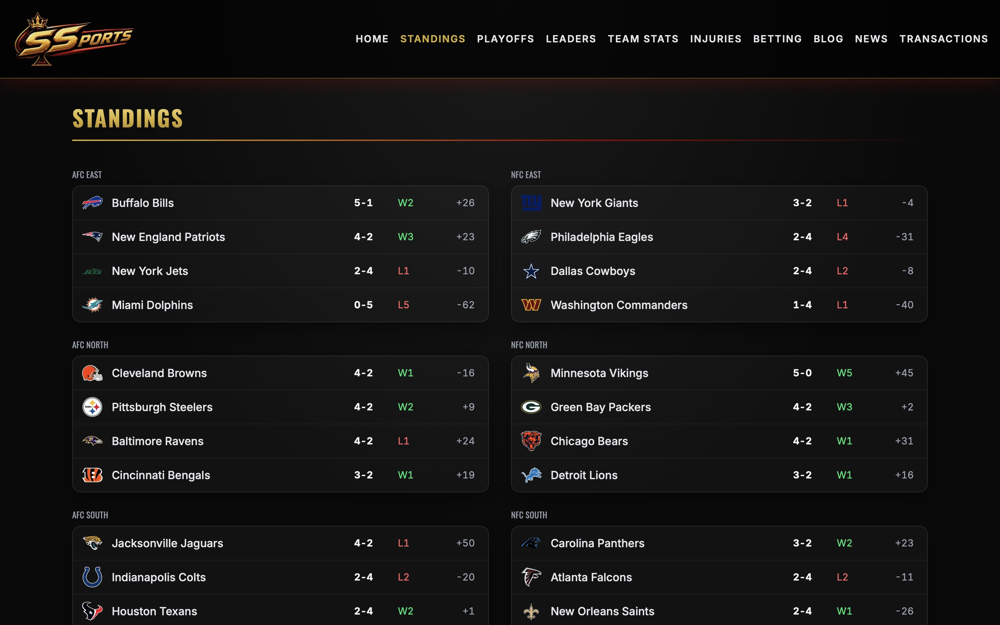

# 🏈 SSports

A full-stack NFL companion site — live scores, standings, team and player stats, game analysis, playoff projections, betting odds, news, transactions, and a custom blog for weekly power & MVP rankings.

**[Live Demo](https://s-sports.netlify.app/)** · **[GitHub](https://github.com/Spencer1923/SSports)**

## What I Built

SSports is a Next.js app that consumes ESPN's public API to deliver an up-to-date NFL fan experience — from scores, standings, and team/player stats to game analysis, playoff scenarios, and betting markets — alongside live news, transactions, and a hand-written blog. The app includes API routes that proxy and reshape ESPN data, dynamic routes for every team, player, and game.

**Highlights:**
- Live scoreboard with week selection, automatic refresh, and score-change animations
- Game pages with team and player box scores, live drives, scoring summaries, betting lines, head-to-head history, and win probability
- Dynamic team pages with schedules, rosters, and depth charts; player profiles with bios and season stats
- League leaderboards and team-stat comparisons for offense and defense
- Playoff simulator with editable game outcomes, projected seeds, and remaining strength of schedule
- Betting odds board with spreads, moneylines, totals, implied probabilities, sorting, and a bet slip
- Live NFL news and transaction feeds, alongside weekly MDX blog posts for power rankings and MVP rankings
- Fully responsive, mobile-friendly navigation

## Screenshots





## Tech Stack

- **Framework:** Next.js 16 (App Router) and React 19
- **Styling:** Tailwind CSS 4 with a custom gold/crimson theme
- **Data:** ESPN's public API (scores, standings, stats, odds, injuries, news, transactions, and team/player data)
- **Client data:** SWR for fetching and refreshing live page data
- **Content:** Markdown/MDX blog posts, parsed with `gray-matter`
- **Deployment:** Netlify

## Features

| Page | Description |
| --- | --- |
| `/` | Live scoreboard, latest articles, and NFL news |
| `/standings` | AFC/NFC standings by division |
| `/playoffs` | Playoff simulator with projected seeds, schedule strength, and clinching scenarios |
| `/leaders` | League statistical leaders across passing, rushing, defense, and more |
| `/team-stats` | Team-level offense and defense statistics |
| `/teams/[teamId]` | Team schedule, roster, depth chart, and history |
| `/players/[playerId]` | Player bio, season stats, and league ranks |
| `/games/[gameId]` | Box score, team/player stats, drives, scoring, odds, and win probability |
| `/injuries` | League-wide injury report |
| `/betting` | NFL odds board, market signals, and bet slip |
| `/news` | NFL news feed |
| `/transactions` | Recent league transactions |
| `/blog` | Weekly power rankings and MVP rankings |
| `/blog/[slug]` | Individual blog article |

The app also exposes internal API routes under `/api` for scores, standings, stats, odds, news, injuries, transactions, and team/player/game data.

## Getting Started

```bash
git clone https://github.com/Spencer1923/SSports.git
cd SSports
npm install
npm run dev
```

Open [http://localhost:3000](http://localhost:3000).

## What I Learned

Building SSports involved working with ESPN's public endpoints and handling inconsistent data shapes, missing fields, caching, and live updates. I also built a cohesive design system with Tailwind CSS 4, reusable data-heavy interfaces, and responsive navigation, and implemented features like depth-chart merging, win-probability displays, betting calculations, and playoff scenario projections.